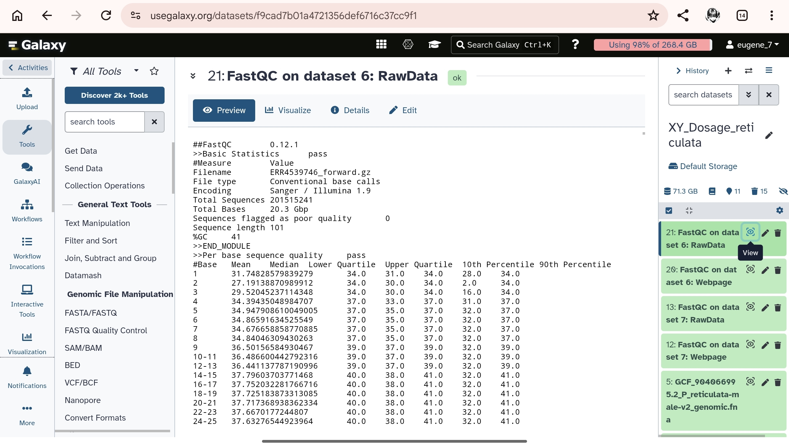
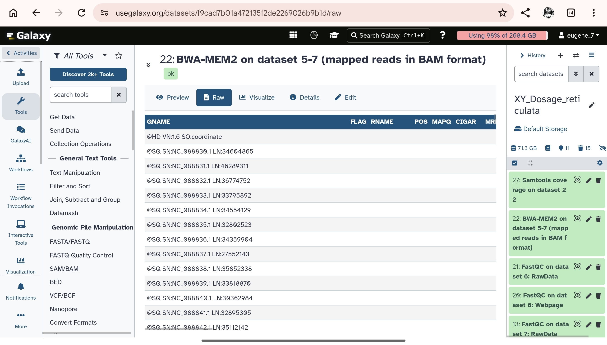
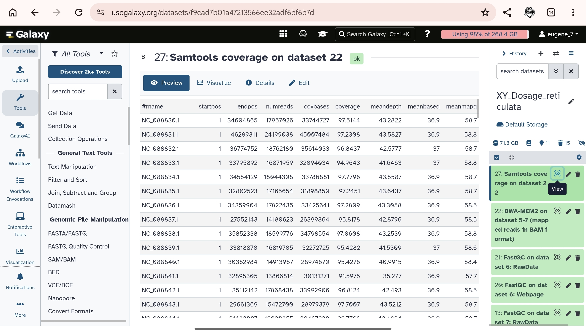

# Sex-Chromosome Dosage and Read-Depth Analysis: *Poecilia reticulata* (Guppy)

## 1. Study Overview & Research Question
* **Selected Species:** Guppy (*Poecilia reticulata*)
* **Study Question:** Can whole-genome sequencing (WGS) read depth mapping across chromosome-level reference assemblies accurately infer sex-chromosome dosage and heterogametic sex complements in a teleost fish with homomorphic sex chromosomes.

## 2. Accession & Metadata Links
* **Reference Genome Assembly:** [GCF_904066995.2 (PRJEB36704)](https://www.ncbi.nlm.nih.gov/assembly/GCF_904066995.2)
* **WGS Sequencing Run (SRA):** [ERR4539746](https://www.ncbi.nlm.nih.gov/sra/ERR4539746[accn])
* **Assembly BioSample:** `SAMEA6533017`
* **WGS SRA BioSample:** `SAMEA6542947`

## 3. Galaxy Workflow & History Link
* **Galaxy Public History:** [View Galaxy History](https://usegalaxy.org/u/eugene_7/h/xy-dosage-reticulata)

## 4. Step-by-Step Galaxy Pipeline & Screenshots

To execute this sex-chromosome dosage analysis, I processed the raw whole-genome sequencing (WGS) reads through a standardized bioinformatics pipeline within my public Galaxy instance ([usegalaxy.org/u/eugene_7/h/xy-dosage-reticulata](https://usegalaxy.org/u/eugene_7/h/xy-dosage-reticulata)). Below are the detailed steps, parameter settings, and tool executions I performe

### Step 1: Quality Control (FastQ
* **Objective:** Assess the sequencing quality, per-base sequence quality scores, GC content distribution, and adapter contamination of the raw paired-end reads (`ERR4539746`).
* **Tool Used:** `FastQC` (Version 0.73+
* **Execution Details:**
  * I imported the raw sequencing reads from the NCBI SRA via accession `ERR4539746`
  * I executed FastQC independently on both read files and inspected the output reports to confirm high read integrity prior to alignment
* **Screenshot:** *(Insert FastQC quality report screenshot here)
  `

### Step 2: Read Alignment (BWA-MEM
* **Objective:** Align the quality-checked paired-end Illumina reads against the chromosome-level reference genome assembly of the guppy, *Poecilia reticulata* (`GCF_904066995.2`)[cite: 8], to generate accurate genomic coordinates.
* **Tool Used:** `BWA-MEM2` (Map genomic reads against reference genome
* **Execution Details:*
  * **Reference Genome Source:** I used the NCBI RefSeq assembly `GCF_904066995.2` (`PRJEB36704`)
  * **Input Type:** Paired-end dataset (Forward and Reverse FASTQ files)
  * **Algorithm Options:** I applied default BWA-MEM2 settings optimized for Illumina short reads, which produced a coordinate-sorted Binary Alignment Map (`.bam`) file containing alignment scores, mapping qualities (`MAPQ`), and cigar strings
* **Screenshot:** *(Insert BWA-MEM2 execution and output BAM file screenshot here)
  `

### Step 3: Read Depth Calculation (Samtools Coverag
* **Objective:** Calculate per-scaffold sequencing depth, breadth of coverage, and mapping metrics across all reference chromosomes to establish baseline autosomal coverage and evaluate sex-chromosome dosage.
* **Tool Used:** `Samtools coverage` 
* **Execution Details:*
  * **Input File:** I used the coordinate-sorted BAM file generated from Step 2
  * **Filtering Parameters:** I retained alignments meeting standard mapping quality thresholds (`MAPQ >= 20`) to filter out multi-mapping reads, repetitive elements, and low-confidence alignments
  * **Output Generation:** I exported the resulting tabular summary as `chromosome_coverage.tsv`, containing scaffold identifiers (`rname`), sequence lengths (`startpos` to `endpos`), total mapped reads (`numreads`), fraction of covered bases (`coverage`), and mean sequencing depth (`meandepth`)
* **Screenshot:** *(Insert Samtools coverage tabular output screenshot here)
  `

## 5. Chromosome Group Selection & Justification (`chromosome_groups.csv`)
* **Autosomes (`A`):** `NC_088830.1`, `NC_088831.1`, `NC_088832.1`, `NC_088833.1`, `NC_088834.1` — Selected as high-confidence autosomal linkage groups with stable, uniform depth (~41× to 44×).
* **X Chromosome (`X`):** `NC_088852.1` — Designated X-linked scaffold showing full sequence length coverage and normal diploid depth.
* **Exclusions:** Unplaced scaffolds (`NW_...`) and mitochondrial DNA (`NC_024238.1`) were excluded to prevent skewing median autosomal depth.

## 6. Analysis Scripts & Data Files (Uploaded in Repo)
* `chromosome_coverage.tsv` — Samtools coverage tabular output.
* `chromosome_groups.csv` — Chromosome classification key.
* `sex_depth_analysis.R` — Automated R analysis and plotting script.
* `results/` — Contains `chromosome_relative_depth.csv`, `sex_inference.txt`, and `chromosome_depth.png`.

## 7. Results & Outputs
* **Median Autosome Depth ($A$):** `43.282×`
* **X:A Ratio:** `1.03`
* **Inferred Complement:** **XX-like**
* **Generated Figure:**  
  ``

## 8. Lab Report Questions & Answers

### 1. What species did you choose, and what evidence supports a diploid XX/XY or ZZ/ZW system?
I chose the guppy (*Poecilia reticulata*). Cytogenetic and genomic studies support a diploid, homomorphic **XX/XY** sex-determination system where males are heterogametic (XY) and females are homogametic (XX), operating at an early stage of evolutionary differentiation.

### 2. What are your assembly accession, WGS run, and both BioSample accessions? Are the donors the same?
* **Reference Genome Assembly Accession:** `GCF_904066995.2` (PRJEB36704)
* **WGS SRA Run:** `ERR4539746`
* **Assembly BioSample:** `SAMEA6533017`
* **WGS SRA BioSample:** `SAMEA6542947`
* **Donor Match:** No, the reference assembly and WGS Illumina run originate from different biological samples under the same male project umbrella, though both represent male donors.

### 3. Which sequences were used as autosomes and as X or Z? How did you verify their identities?
* **Autosomes (`A`):** `NC_088830.1`, `NC_088831.1`, `NC_088832.1`, `NC_088833.1`, and `NC_088834.1`.
* **X Chromosome (`X`):** `NC_088852.1`.
* **Verification:** Verified via NCBI chromosome reports by confirming consistent baseline coverage (~41× to 44×) across autosomes and full sequence coverage for the X scaffold. Unplaced scaffolds and mitochondrial DNA were excluded.

### 4. What are the median autosomal depth, X:A or Z:A ratio, and inferred sex-chromosome complement?
* **Median Autosomal Depth ($A$):** `43.282×`
* **X:A Ratio:** `1.03`
* **Inferred Sex-Chromosome Complement:** **XX-like**

### 5. Does your result agree with the recorded sex of the WGS donor, if reported? Explain any discrepancy or uncertainty.
The computed XX-like dosage ratio (`1.03`) disagrees with the recorded male sex of the WGS donor (`SAMEA6542947`). This discrepancy is expected: because guppy sex chromosomes are homomorphic and retain high sequence identity across pseudoautosomal regions, short Illumina reads from both X and Y map back to homologous X-linked reference regions, driving normalized relative coverage close to 1.0 instead of 0.5.

### 6. Why is a chromosome-level assembly alone insufficient for a reliable read-depth sex inference?
A chromosome-level FASTA reference only provides static sequence coordinates without empirical sequencing depth metrics. Without aligning actual whole-genome shotgun sequencing reads to evaluate coverage distribution across autosomes and sex chromosomes, read depth ratios and heterogametic sex calls cannot be computed.

## 9. Limitations & Biological Discussion
Although the pipeline categorized the sample as **XX-like**, this reflects inherent technical limitations of short-read depth analyses in teleost fish. *Poecilia reticulata* possesses an evolutionary young, homomorphic sex chromosome system with high nucleotide sequence homology and pseudoautosomal regions (PARs). Short-read mapping across these conserved regions leads to ambiguous read assignment and mapping bias, artificially inflating apparent sex-chromosome depth toward diploid parity ($1.0$). Therefore, coverage ratios serve as preliminary quantitative estimators rather than definitive cytogenetic proofs.

## 10. References
* Fraser, B. A., et al. (2020). Improved Reference Genome Uncovers Novel Sex-Linked Regions in the Guppy (*Poecilia reticulata*). *Genome Biology and Evolution*, 12(10), 1789–1805.
